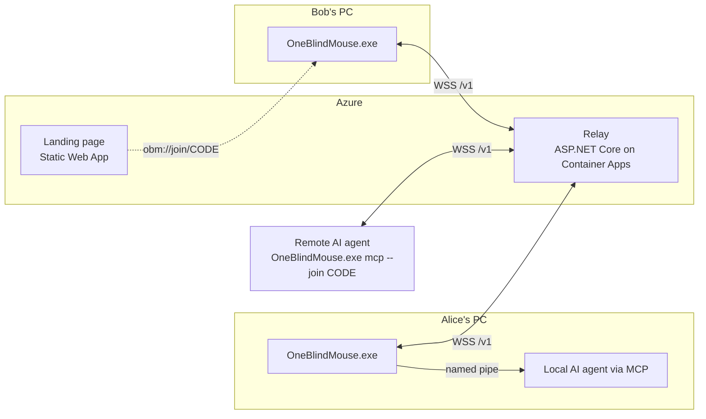
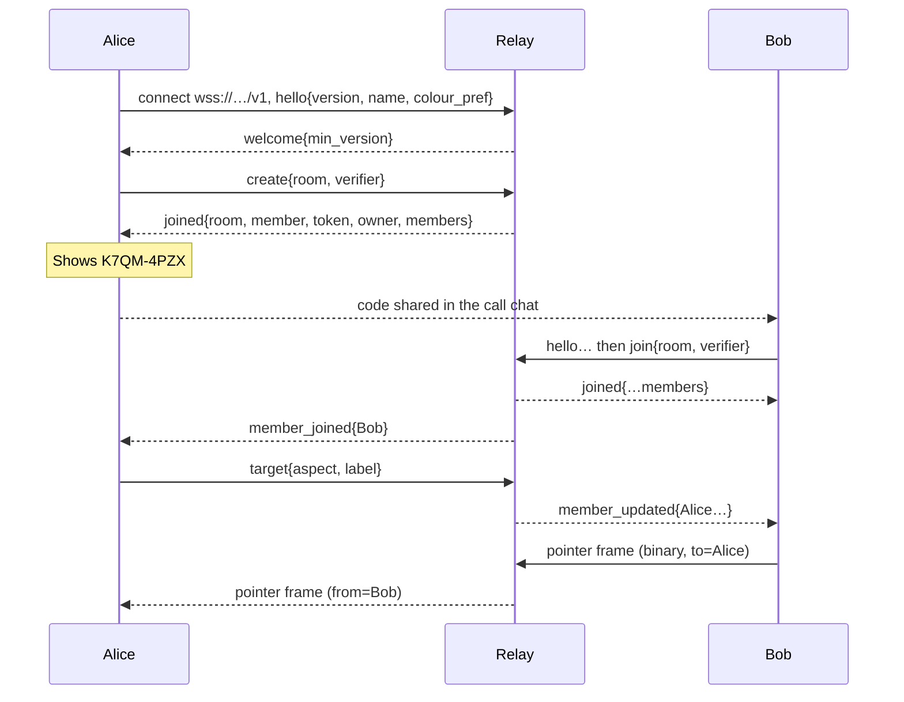

# One-Blind-Mouse — Design

> A portable Windows tray app that lets people, and AI agents, show a named, coloured pointer on someone else's screen.
> It is a communication aid for screen-share calls. It is **not** remote control: pointers never click, type or take focus on the receiving machine.

## 1. Goals and non-goals

| Goals | Non-goals |
|---|---|
| One portable exe: no installer, no admin rights, no sign-in | Remote control or input injection |
| The user experience is **run it → share a code → see the pointer** | Screen sharing (people keep using Teams, Zoom, Meet, …) |
| Peers are symmetric: every instance can send and receive pointers | Accounts, contact lists or discovery |
| Works across the internet, behind NAT, proxies and firewalls | Sending screen content or files |
| Secure by default: a code is needed to join, and the owner can remove anyone | Guaranteed delivery of every pointer sample |
| AI agents can point, locally (MCP / named pipe) or remotely (joining with a code) | |

## 2. User experience

### 2.1 Starting and joining
1. The user runs `OneBlindMouse.exe`. A tray icon appears and a small popup shows **this instance's code**, e.g. `K7QM-4PZX`, with **Copy** and **Copy link** buttons.
2. The user pastes the code (or link) into the call chat. The other person runs the app, pastes it into **Join someone** and presses Enter.
   When the popup opens it pre-fills the join box if the clipboard holds a code or link, so joining is usually one click.
3. Everyone sees a notification ("Alice joined"). Joins are accepted automatically; the owner can remove people from the tray menu.

Every instance always has its own room and code, so it doesn't matter who shares first. Joining someone else's code moves you into their session; **Leave** returns you to your own.

### 2.2 Pointing (sending)
- **Hold Right Ctrl** (configurable: Right Ctrl, Right Shift, Scroll Lock, Pause) to point. While held:
  - the cursor is confined to the **frame** under it (see §5), and its position is sent as a fraction of that frame;
  - local clicks and the wheel are swallowed so nothing local is clicked by accident;
  - left click = ripple, left drag = laser trail, right click = pulse, wheel = pointer size.
- Releasing the key, pressing **Esc**, pressing any other key (e.g. a Ctrl+C shortcut), locking the workstation or leaving the session stops pointing and hides the pointer.
  The hold key itself is never swallowed, so Ctrl shortcuts keep working.
- With several people in a session, the pointer goes to an automatically chosen person (the only other person, otherwise the owner) or to a person chosen in the tray menu.

### 2.3 Receiving
- Remote pointers are drawn above everything on this user's **shared area**: a chosen monitor (default: primary) or a picked window's client area. It should match what the user is sharing in the call.
- Pointers carry the member's name and palette colour. They are click-through, never take focus, and hide when the sender stops or goes silent.
- **Show pointers in my screen share** (default on) controls whether overlay windows appear in screen captures. Turning it off uses `WDA_EXCLUDEFROMCAPTURE`.

### 2.4 Links
`https://<site>/j/K7QM4PZX` opens a landing page that tries `obm://join/K7QM4PZX` and otherwise offers the download and shows the code to paste.
The `obm://` handler is written to `HKCU\Software\Classes\obm` only when the user opts in from the tray menu ("Open join links with this app"), so the app stays install-free by default.
A registered handler is re-pointed at the current exe at startup, because a portable exe can move.

## 3. Architecture



| Path | Contents |
|---|---|
| `src/OneBlindMouse.Core` | Protocol messages, the 12-byte pointer frame, session codes, palette, name sanitising, pointer smoothing and `RelayClient` (the client state machine). No dependencies beyond .NET |
| `src/OneBlindMouse.Relay` | The WebSocket relay: in-memory rooms, join checks, rate limits |
| `src/OneBlindMouse.Windows` | The tray app (NativeAOT, Win32 P/Invoke, GDI+). Also the MCP server (`mcp` sub-command) |
| `tests/OneBlindMouse.Tests` | Unit tests and end-to-end relay/client tests against an in-process relay |
| `infra/` | Bicep for the Azure resources, and `deploy.ps1` |
| `web/` | Static landing and join pages |

## 4. Connection mechanics

### 4.1 Why a relay
The only transport that works on every network (corporate proxies, hotel Wi-Fi, symmetric NAT) is **outbound TLS on port 443**, so every client keeps one WebSocket to a small relay.
Pointer traffic is tiny (12-byte frames at up to 30 Hz), so the relay is billed by compute, not messages, and scales to zero when nobody is connected.
Managed pub/sub services with per-message pricing were rejected for cost.
The relay URL is compiled into the app; users never see or configure it. A direct peer-to-peer upgrade is future work (§9).

### 4.2 Codes
```
K7QM-4PZX  =  room (3 chars, 15 bits)  +  secret (5 chars, 25 bits)
```
- Crockford base32 (`0-9 A-Z` without `I L O U`), so codes are easy to read aloud. Input ignores case, spaces and hyphens, and also accepts `/j/CODE` URLs and `obm://join/CODE`.
- The **client** generates both parts with `RandomNumberGenerator`. It creates its room by sending the room id and `verifier = HMAC-SHA256(key: secret, msg: room)`.
  Joiners send the same verifier, so the relay checks codes without storing the secret.
- **Guessing is online only and rate limited.** After 5 wrong codes a room locks and the owner's client immediately rekeys (new secret, same members). Failures are also limited per IP (20 per 10 minutes).
- **New code** (owner only) rekeys on demand. A code lives as long as its owner is connected.

### 4.3 Sequence


- **Reconnect.** Exponential backoff with jitter. The client resumes with `resume{room, member, token}`; the relay holds a disconnected member's slot for 30 seconds, so brief network drops are invisible.
  If the resume fails, the client rejoins with the code it holds (or recreates its own room).
- **Keepalive.** WebSocket pings every 20 s keep NAT and proxy mappings open and detect dead connections.
- **Proxies.** `ClientWebSocket` uses the system proxy settings, so corporate proxies work without setup.
- **Ownership.** If the owner leaves, ownership passes to another member and the room stays open.

### 4.4 Relay limits
- 8 members per room (one per palette colour; slots are assigned in join order, honouring a free preferred colour).
- Control messages: 2 KB maximum, 20/s (burst 40). Pointer frames: exactly 12 bytes, 60/s (burst 120); excess frames are dropped.
  Violations accumulate cost and repeated abuse disconnects the client.
- Room creation 5 per minute per connection; 20 concurrent connections per IP. A 10 s hello timeout. Bounded outbound queues; slow receivers lose pointer frames, not the connection.
- No message contents are logged. `/healthz` reports health. `welcome{min_version}` lets old clients be told to update.
- `X-Forwarded-For` is trusted only when running in Azure Container Apps (the `CONTAINER_APP_NAME` variable is set).

### 4.5 Wire protocol
Control messages are JSON text frames with a `type` discriminator:

| Client → relay | Relay → client |
|---|---|
| `hello{version, name, colour_pref}` | `welcome{min_version}` |
| `create{room, verifier}`, `join{room, verifier}`, `resume{room, member, token}`, `leave` | `joined{room, member, token, owner, members[], resumed}` |
| `kick{member}`, `rekey{verifier, secret}` (owner) | `member_joined`, `member_updated`, `member_left`, `owner_changed`, `rekeyed{secret}`, `locked`, `kicked` |
| `rename{name}`, `target{aspect, label}` | `error{code, message}` |

Pointer samples are 12-byte binary frames (little endian):

```
[0] type = 0x01   [1] from (set by the relay)   [2] to (0 = everyone)   [3] reserved
[4..5] seq        [6..7] x   [8..9] y  (0..65535 across the receiver's area)
[10] flags: visible | click | pulse | laser       [11] size percent (50..250)
```

- Senders send on change at up to 30 Hz and repeat the last sample every 0.5 s while visible; receivers hide a pointer that has been silent for a few seconds.
- Receivers buffer samples briefly (`PointerSmoother`) and interpolate, so movement is smooth despite network jitter. Stale and out-of-order samples are dropped by sequence number.
- Every received field is validated on both relay and client: lengths, ranges, known types, sanitised names (24 chars) and labels (64 chars).

## 5. Coordinates, targets and frames

- **The receiver owns the coordinate space.** A position is a fraction of the receiver's shared area (monitor or window client area), mapped to physical pixels as `left + f × (width − 1)`.
  The app is Per-Monitor-V2 DPI aware, so the sender never needs the receiver's resolution or DPI.
- Each receiver publishes `target{aspect, label}` (e.g. `1.778`, "Screen 1 of 3" or the window's app name). It re-checks once a second and sends only on change.
  A closed shared window falls back to the configured monitor.
- **Frames (sender side).** While pointing, the sender's cursor is confined to a frame that should match the remote screen as it appears in the call window:
  - by default, the client area of the top-level window under the cursor (the meeting app's window), or the monitor if the cursor is over the desktop or taskbar;
  - optionally a **drawn frame**: "Pointing frames → Draw a frame inside a window…" lets the user drag a rectangle (e.g. exactly around the shared video), stored as fractions of that window so it follows resizes;
  - the frame is then **letterboxed to the recipient's aspect ratio**, which matches how meeting apps letterbox shared screens.

## 6. Windows app

- **NativeAOT** single exe (about 6 MB), no runtime required. Pure P/Invoke (user32, gdi32, GDI+, shell32, dwmapi) and built-in .NET JSON/WebSockets; no NuGet packages.
- **Threads.** One UI thread runs a Win32 message loop (`UiDispatcher`), which also owns timers and receives work posted from other threads.
  `RelayClient` runs on the thread pool; its events are marshalled to the UI thread.
- **Overlay.** Each pointer, trail, effect and annotation is a small layered, transparent, topmost, no-activate sprite window drawn with GDI+ and `UpdateLayeredWindow`.
  Only changed sprites are redrawn, and the 16 ms animation timer runs only while something moves.
- **Transmitter.** A low-level keyboard hook is always installed (to see the hold key). A low-level mouse hook is installed only while pointing, picking a window or drawing a frame, and swallows clicks then.
  A transparent capture window under the cursor keeps hover effects and tooltips from triggering in the app underneath.
  Hooks run with no blocking work, and the cursor clip is released on stop, crash, Esc or workstation lock.
- **Tray icon** in the user's palette colour (grey when offline). Left click toggles the session popup; right click opens the menu:
  show session, point on ▸, what I'm sharing ▸ (monitors / pick a window), pointing frames ▸, hold key ▸, pointer size ▸, show pointers in my screen share,
  open join links with this app, copy code, copy join link, new code, leave session, remove ▸ (owner), quit.
- **Session popup**, centred on the primary monitor: code, copy buttons, join box, member list, name, leave, new code, a usage hint and a "Minimise to tray" button. Clicking elsewhere or pressing Esc also hides it; the app keeps running in the tray.
- **Single instance** per user, logon session and profile (named mutex). A second launch forwards its join code (or "activate") to the running instance over the local pipe and exits.
- **Settings** (`%APPDATA%\OneBlindMouse\settings.json`): name, colour preference, hold key, shared monitor, pointer size, show in capture. Crash logs go to the same directory.
- **Testing options.** `--profile NAME` isolates settings, mutex and pipe so several instances run side by side; `--title-tag TEXT` prefixes window titles.
  Debug builds accept `OBM_RELAY_URL` and `OBM_WEB_URL` environment overrides; release builds ignore them.

## 7. AI agents

### 7.1 Local agents (same PC)
`OneBlindMouse.exe mcp` is an MCP server over stdio (newline-delimited JSON-RPC). It starts the tray app if needed and forwards tool calls to it over the named pipe.

| Tool | Purpose |
|---|---|
| `get_screen_layout` | Monitors (physical bounds, scale), cursor, foreground window client area. Call first to convert screenshot positions |
| `point_at{x, y, label?, colour?, duration?}` | Glide the agent pointer to physical pixel coordinates and pulse there |
| `show_click{x, y, label?, colour?, duration?}` | Glide the agent pointer there and play two click ripples, to prompt a click (does not click) |
| `circle{x, y, width, height, label?, colour?, duration?}` | Glide to the area and draw a hand-drawn ellipse just outside it |
| `highlight_rect{x, y, width, height, label?, colour?, duration?}` | Outline a rectangle |
| `trace_path{points[], colour?, duration?}` | Arrow along 2–256 points |
| `clear` | Hide the agent pointer and remove agent annotations |
| `get_session`, `join_session{code}` | Session code and members; join a session |

Agent annotations are drawn locally in amber by default and are not sent to other members. Durations are 0–600 s (0 = until cleared); for the pointer and
circle they count from arrival. There is a single agent pointer: each `point_at`, `show_click` or `circle` glides it from its current position, or from
the user's cursor when it is hidden, with an eased motion and a trail, so the user's eye can follow it. A new call cancels any unfinished motion.

Example MCP configuration (`~\.copilot\mcp-config.json` for Copilot CLI):
```json
{ "mcpServers": { "one-blind-mouse": { "type": "local", "command": "C:\\Users\\<user>\\AppData\\Local\\OneBlindMouse\\OneBlindMouse.exe", "args": ["mcp"], "tools": ["*"] } } }
```

The MCP server's instructions describe the tools and the coordinate space (physical virtual-desktop pixels). Agent skills that decide when to point, and how
to obtain and register the tool, are kept outside this repository.

The pipe (`\\.\pipe\OneBlindMouse-<sid>-<session>[-profile]`) accepts JSON lines `{id, cmd, …}` and replies `{id, ok, result | error}`.
It is created with `CurrentUserOnly`, requests are capped at 64 KB and all arguments are validated (coordinates within the virtual screen, colours `#RRGGBB`, sanitised labels).

### 7.2 Remote agents
`OneBlindMouse.exe mcp --join CODE [--name NAME]` joins a session as its own headless member, so an agent on another machine can point on the people's screens.
Tools: `get_session` (members, what each shares and its aspect ratio), `point_at{x, y, duration?}` and `show_click{x, y}` with fractions 0–1 of the receivers' shared areas, and `clear`.

## 8. Security summary
- Joining needs the full code; guessing is online only, rate limited per room and IP, and triggers an automatic rekey. Every join is announced, every pointer is named, and the owner can remove anyone.
- Pointers can't click, type or take focus; overlays are click-through, no-activate windows.
- No screen content leaves the machine. The relay sees names, target labels/aspects and pointer coordinates (TLS in transit); v1 trusts the relay.
- All network input is validated on both sides. The relay URL is compiled in and can't be changed by a link or argument in release builds. Links only ever carry a code.
- The local pipe is restricted to the current user; the `obm://` handler is opt-in and HKCU only.

## 9. Future work
- **Peer-to-peer upgrade.** Keep the relay for control and fallback; exchange candidates through it, punch a direct UDP path (public STUN; Container Apps ingress is TCP only), and move pointer frames to it with AES-GCM keyed by ECDH plus the code secret.
  Falls back to the relay if the direct path goes quiet. Matters most when peers are close to each other but far from the relay.
- **End-to-end encryption** with a PAKE keyed by the code secret, if the relay should become untrusted (the current verifier would then be replaced, since it allows offline guessing by the relay).
- macOS and Linux clients (the Core library and protocol are platform-neutral), a browser sender, code signing, optional join approval.

## 10. Deployment (one-time)
`./infra/deploy.ps1 -Subscription <name or id> -ResourceGroup rg-one-blind-mouse [-Location australiaeast] [-CustomDomain one-blind-mouse.rylogic.co.nz]` creates Log Analytics, a Container Apps environment and a Static Web App,
deploys the relay from the public `ghcr.io/psryland/one-blind-mouse-relay:latest` image (pinned by digest; built by the `Relay image` GitHub workflow on changes to the relay or Core),
uploads `web/`, and prints the relay URL and site address.
With `-CustomDomain`, it also adds that domain to the Static Web App, which issues a free certificate. The domain needs a CNAME record pointing at the site's default
host name (`<name>.azurestaticapps.net`) first. The live site is https://one-blind-mouse.rylogic.co.nz; links on the default host name keep working.
Compile those into `AppConfig` (`DefaultRelayUrl`, `DefaultWebUrl`) and the site's download link (`web/js/config.js`), then publish the app:

```powershell
dotnet publish src/OneBlindMouse.Windows -c Release -r win-x64
```

The relay keeps rooms in memory, so it runs at most one replica; restarting it drops sessions, and clients reconnect and recreate their rooms automatically.
It scales to zero when no client is connected, so it costs nothing while unused. The first connection after that waits a few seconds while a replica starts.
